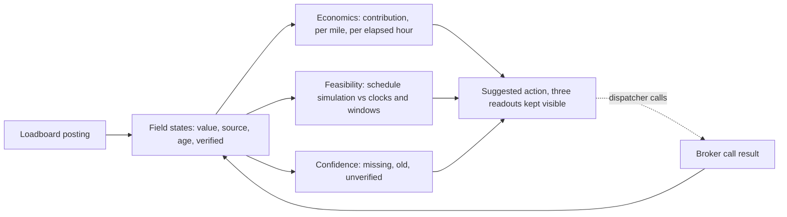

# Load Decision Confidence

A working prototype exploring one question in modern dispatch: **how confidently can a dispatcher act on a single load opportunity?**

Live demo: https://class8-load-decision-confidence.pages.dev/

Built by Abhinav Jha as a pitch piece alongside his application for the Senior Frontend Engineer role at Class8. It is an independent exploration based on Class8's public product descriptions. It is not affiliated with or endorsed by Class8, and it uses an illustrative dataset, not live market data.

## The problem, in Class8's own words

Class8's public material describes the dispatcher's world precisely:

- "Loadboard postings are often stale and have inaccurate or missing details." (Caller Assistant listing, Chrome Web Store)
- "Per mile rates in a lane can fluctuate by a full dollar in a single day." (class8.com/our-solution)
- A dispatcher is "tracking market prices, fuel costs, driver preferences, ETAs, Hours-of-service, pickup and drop-off schedules, and that's just the tip of the iceberg." (class8.com/our-solution)
- Load Optimization is pitched on "rates, timing, and empty miles" and on increasing "profit per mile". (DTNA launch release; class8.com/drive)

A posted rate is not a decision. It says nothing about the deadhead miles to pickup, the fuel burned across loaded and empty miles, whether the driver can legally and realistically make the appointments, or whether the details on the posting can be trusted at all. Class8 already works on this problem with Load Optimization, Dispatch AI and Voice AI. This prototype explores the surface where those capabilities meet the dispatcher: a per-load decision that shows its economics, its feasibility and its information quality separately, with every assumption in plain text.

The full evidence base is in [research/claims-sheet.md](research/claims-sheet.md). Every claim in it is a verbatim quote with a source. No user reviews of Class8 were found anywhere public, and none are used or invented here.

## What the prototype does

One truck (Dallas, dry van, stated driver clocks), twelve loadboard-style postings. Each load gets three independent readouts, never collapsed into one score:

1. **Economics.** Contribution after mileage-dependent and load-specific costs: contribution in dollars, per total mile (loaded plus deadhead), and per elapsed truck-hour from a schedule simulation that counts breaks and mandatory rest. Driver compensation and fixed carrier costs are excluded and the page says so.
2. **Feasibility.** A preliminary warning from estimated times: estimated pickup and delivery arrivals against the appointment windows, slack in minutes, and the binding constraint named in words. States: Fits, At risk, Does not fit, Cannot determine. The page carries the line: "Preliminary feasibility warning from estimated times. Not a compliance check."
3. **Confidence.** Per-field state (posted, missing, not recently verified, call-verified) for rate, windows, equipment and weight, independent of whether the load is attractive.

A rule-based suggested action sits under the three readouts. A "Simulate broker call" button on each load applies a scripted call result: fields become verified, values update, and all three readouts recompute, because a call changes the decision.



## What the numbers say

Computed by the prototype itself on the shipped dataset, at the default assumptions (diesel $6.13 per gallon, EIA US average for the week of Nov 9 2026):

- The load with the best headline rate, $5.71 per loaded mile, ranks **10th of 11** rateable loads by contribution per total mile, at $0.76. Its 390 deadhead miles are invisible in the headline.
- The best contribution per total mile, $2.06, belongs to a load ranked only third by headline rate.
- One load in twelve cannot make its pickup window under the driver's current clocks, despite a positive contribution. Nothing about its rate reveals that.
- Counting a mandatory 10-hour rest, the long Atlanta load returns $40.03 per elapsed truck-hour against $55.10 for the short Houston load. Ignore rest time and the ranking reverses, which is how a naive per-hour metric misleads.
- A broker call on the Nashville load raises its information confidence to High and lowers its contribution from $862 to $742 at the same time. Verification and attractiveness are different facts, and the interface keeps them separate.

## The model

The full build-ready model is [research/phase2-model-v2.md](research/phase2-model-v2.md). Defaults are planning assumptions, all editable on the page: diesel $6.13/gal at 6.5 MPG, maintenance reserve $0.20/mile and tires $0.05/mile (in line with ATRI 2025 reporting), DEF $0.03/mile, planning speed 45 mph, split handling and dwell inputs, and a configured equipment payload limit of 45,000 lb.

Two things were deliberately removed during design, because they misled: an "operating profit" metric (driver compensation alone runs about $1.03 per mile in ATRI figures; without it, any profit label is false precision) and a per-mile fixed-cost allocation (it charges two loads with identical miles and very different hours the same amount).

## Process

Research first, build second, which the commit history mirrors:

1. Claims sheet extracted verbatim from Class8's own pages, releases and job posts.
2. A first model, then two structured teardown passes (an external reviewer model instructed to attack the concept, the economics and the dataset). The teardowns killed the original "true profit" framing, forced the elapsed-time schedule simulation, and separated confidence from recommendation. Digests: [research/chatgpt-teardown-phase1.md](research/chatgpt-teardown-phase1.md) and [research/chatgpt-teardown-phase2.md](research/chatgpt-teardown-phase2.md).
3. The corrected model (v2), then this prototype.

## Run it

```bash
cd app
npm install
npm run dev
```

Production build: `npm run build`. The demo at the link above is that build, served from the `docs/` folder of this repo.

## Limits

Illustrative dataset of twelve hand-designed loads; destination market tags are a static illustration, not live market data; scripted broker call results are authored examples of the update types, not real broker data; the schedule simulation is a planning estimate with stated assumptions, not an hours-of-service compliance tool.
